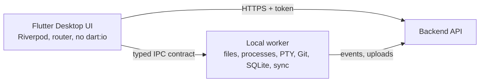

# Architecture

Full design: `main/sad_v1.md`. This page is the short map.

## Processes on the student's computer

| Process | Does | Must not |
|---|---|---|
| Flutter Desktop UI | Draws UI, holds UI state, navigation, native editor (`re_editor`) | Touch files, run processes directly (banned from `dart:io`) |
| Local worker | Detect environment, run approved tasks, terminal/PTY, local store, sync, snapshots | Accept unvalidated command strings or path traversal |

## Cloud

| Part | Does |
|---|---|
| Backend API (`services/api`) | Validates tokens, profiles, catalogue, attempts, progress events, tutor proxy, submissions, scores |
| Grader (`services/grader`) | Orchestrator verifies and signs; Runner executes student code; Harness runs protected tests |
| Content pipeline (`services/content-ci`) | Validates labs and publishes bundles |
| Storage | Bundles, snapshots, protected tests (separate project for the grader) |

## Verified grading flow

Student confirms files, the app uploads a snapshot, the API enqueues a job, the Orchestrator fetches the snapshot and protected tests, the Runner runs the Harness, the Orchestrator parses and signs the result, the API recomputes the score and stores an insert-only record.

## Communication rules

1. UI to worker only through channels in `packages/ipc_contract` (`IPC_API.md`). The UI layer is banned from `dart:io` `File` and `Process` APIs.
2. App to cloud only through the backend API (`BACKEND_API.md`) with a bearer token.
3. Backend to grader only through the job queue; the grader returns signed results to one internal endpoint.
4. Nothing on the student's machine ever receives protected tests.
