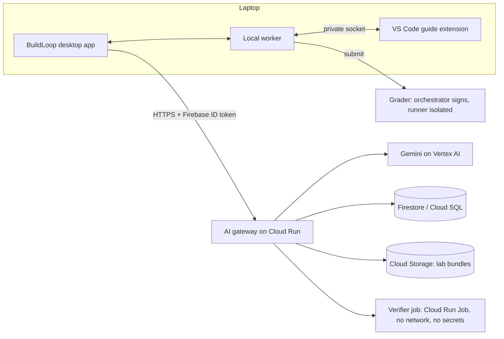

# Startup Buildathon India 2026: plan to win

Status: Draft 2026-11-06. Owner: founders. Source of truth for rules: startupbuildathon.com and hack2skill.com/event/buildathon/tnc (re-read before submitting; the terms page is a generic template).

## 1. Dates (from the programme page)
| When | What |
|---|---|
| **13 Nov** | Applications close (idea, solution, architecture, pitch deck) |
| by 18 Nov | Selected teams hear back |
| 20-21 Nov | City Buildathon, **Bengaluru** (Day 1 ideate, Day 2 build and present; bring a laptop) |
| 23 / 25 / 27 Nov | Regional Showcases (Gurugram / Mumbai / Hyderabad) for top teams |
| 2 Dec | Grand Finale at Google, Bengaluru; top 10 win USD 5,000 cash + USD 5,000 Google AI and Cloud credits each |

## 2. What the judges score (programme page) and our answer
| Criterion | Our answer | Evidence we need |
|---|---|---|
| Founder profile | [TO FILL: why you, why this problem] | Short founder story; any relevant projects |
| Product potential | Placement-readiness gap: students arrive without real tool skills | Working product + pilot results |
| Market viability | College students and recent graduates who want better placement | Sourced market numbers [TO RESEARCH], pilot demand, pricing idea |
| Technical architecture | Desktop app + VS Code guide + private local channel + server-side grader + Google Cloud AI gateway | Architecture diagram (section 5), security programme in `docs/security/` |
| Use of Google AI | Gemini drives roadmap planning, lab generation and tutoring; deployed on Google Cloud | Live demo of all three on Google Cloud |

## 3. The one-line story
**"Get placement-ready with proof."** Tell BuildLoop the job you want. Gemini builds your path, generates and verifies the labs, and coaches you in your language. Only a server-run test can award a badge, so AI never grades.

## 4. Scope: two engines and a tutor (this makes your five features one build)
1. **Roadmap Planner** (input: a job description, a role, or a topic/subject) -> an ordered path of labs. It picks existing verified labs and lists gaps to generate. Output is validated against a schema, never free text.
2. **Lab Generator** (input: a topic, a lab spec from the planner, or a GitHub repo) -> a complete lab: guide steps, starter code, visible tests, protected tests and a reference solution. **Generate-and-verify:** a sandbox runs the generated reference solution (must pass) and the starter (must fail) before any student sees the lab. Content-ci schema checks run too. This is the answer to "AI makes mistakes".
3. **Tutor + language** (inside the VS Code guide panel) -> hints in levels, never the full answer, replies in the learner's language (Hindi, Kannada, Tamil and others). Language is a parameter, not a separate build.

## 5. Architecture (what exists, what to build)

| Piece | Status today |
|---|---|
| Desktop app, sign-in, dashboard, course and lab pages | Built (sample data for courses) |
| VS Code guide extension + local worker + private channel | Built and verified on Linux |
| Security programme, scanner, threat model | Built |
| Grader (server-side Verified scoring) | Designed and partly built in `services/grader`; not wired to the app |
| AI gateway code in `services/api` (provider port, Gemini adapter, limits, redaction) | Built and unit-tested with a fake model; **not run against live Gemini or deployed** |
| Roadmap Planner and Lab Generator with generate-and-verify (code) | Built and tested with a fake model; production verifier job and the app screens still to build |
| Tutor language setting in the API | Built; the guide panel does not call it yet |
Rules that stay: the app never holds a provider key (ADR-007); everything sent to Gemini is redacted first (SEC-10); model output is schema-validated before use (AIR-08); AI never decides a score (TRU-03).

## 6. Timeline (7 days to apply, then the event)
| Days | Goal | Output |
|---|---|---|
| 6-7 Nov | Decide name, get Google Cloud project and Gemini access, create the AI gateway skeleton | Gateway on Cloud Run answering one health call |
| 7-9 Nov | Roadmap Planner end to end | Paste a job description, get a validated path |
| 9-11 Nov | Lab Generator with generate-and-verify | One generated lab that passes its own verification, opened in VS Code |
| 8-12 Nov | **Pilot** with 20-30 students (see section 7) | Numbers, quotes, a short report |
| 12-13 Nov | Write and submit | Application form, deck, architecture diagram, 2-minute demo video |
| 14-19 Nov | Harden the demo, add tutor + language | A demo that works every time |
| 20-21 Nov | Event | Build Day 2 on top of what exists; rehearse a 7-minute demo + 3 minutes questions |

## 7. Traction plan (no users yet, so build proof fast)
- Recruit 20-30 students (18+ only, per ADR-012) from your college, clubs and WhatsApp groups. Ask for one real session: install, run one lab, fill the feedback form (`tests/usability/feedback_form.md`).
- Get consent in writing for using their feedback; collect no personal data you don't need.
- Measure: sign-ups, labs started, labs completed, minutes to first pass, where they got stuck, "would you use this for placement prep" (1-5), and 3 short quotes.
- Even a small honest number beats a big vague claim.

## 8. Risks and how we answer them
| Risk | Answer |
|---|---|
| "Another edtech" | Placement proof from real tool work, verified by execution; not DSA or video courses |
| AI-generated labs may be wrong | Generate-and-verify in a sandbox before release; AI never grades |
| Students won't pay | Free core labs; paid verified passport, mentor review, college licences later [validate with the pilot] |
| Terms: IP right of first refusal for 6 months on what you submit | Get legal advice before submitting; submit only what you must |
| Existing code | Terms allow work based on an existing application if you own the rights; ask the organiser what must be built during the event |
| 7 days is short | Build one thin path through all three engines, not every feature |

## 9. Open items for the founders
Final product name (Q-008), founder story, who does what, college and city, Google Cloud project, Gemini access, pilot list, legal review of the IP clause.
