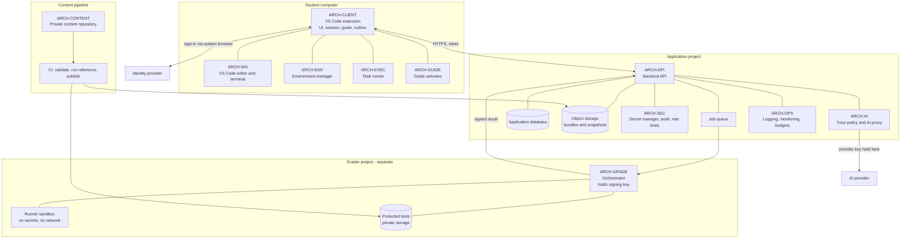
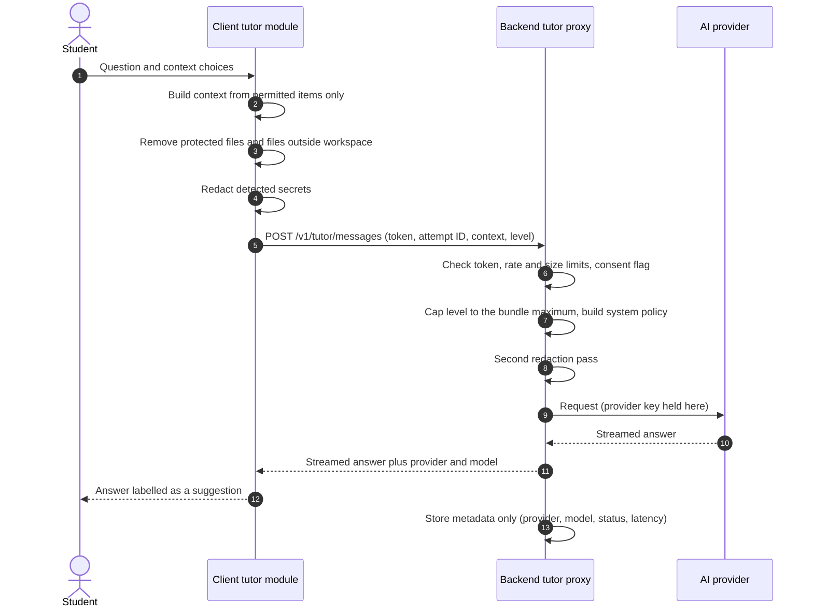
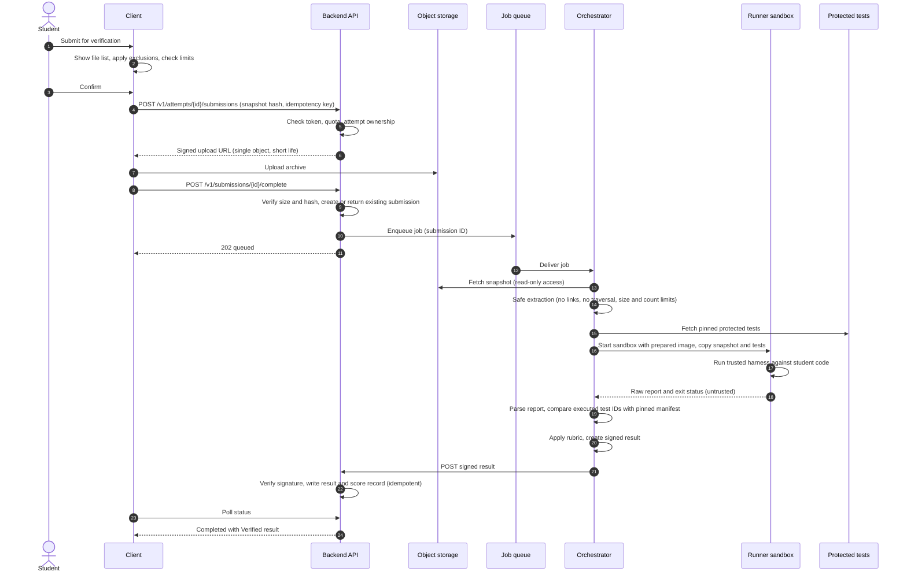
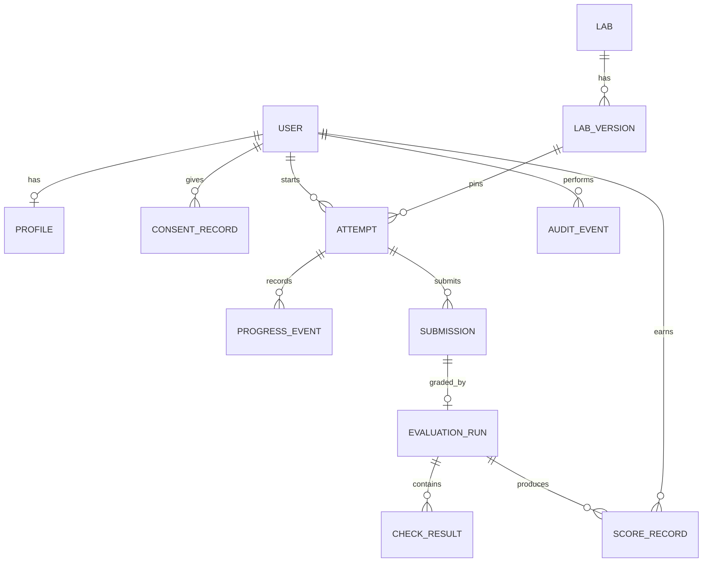
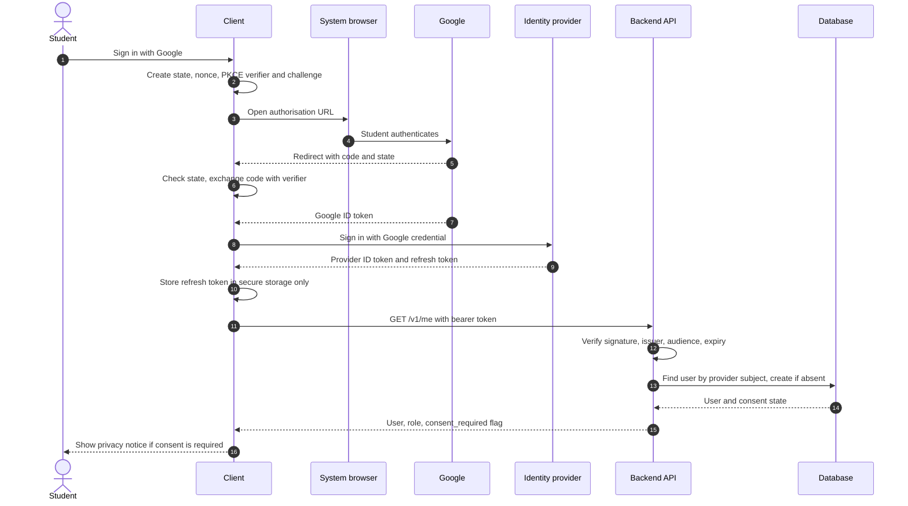
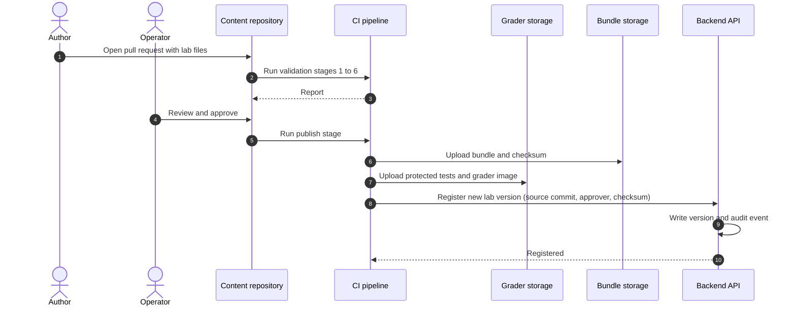
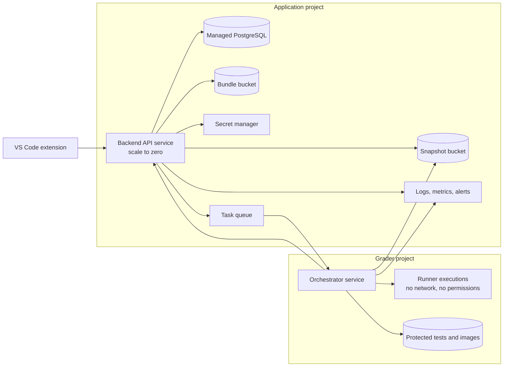

# Software Architecture and Design Specification (SAD)

## AI-Assisted Software Learning Platform

| Document control | Value |
|---|---|
| Document ID | SAD-ASLP-001 |
| Version | 1.2-draft (Flutter desktop shell selected; macOS in MVP; see Section 4.1) |
| Status | Draft for architecture review |
| Prepared | 3 November 2026 |
| Supersedes | `sad.md` v0.1 (see Section 11.3) |
| Implements | `srs_v1.md` v1.2-draft |
| Based on | `idea_v1.md` (Concept v1) |
| Architecture owner | TBD |
| Approval | Pending |

> **How to read this document.** This SAD describes how the requirements in `srs_v1.md` will be met. It is a design proposal, not evidence that anything is built. Where the SRS leaves a decision open (TBD-nn), this document gives a **working hypothesis** and the spike that confirms or rejects it (Section 12). Requirement IDs (`FR-*`, `NFR-*`) refer to the SRS; `ARCH-*` component IDs are the SRS component IDs. Cross-references are checked by `tools/check_sad.py`.

---

# 1. Introduction

## 1.1 Purpose and scope

This document defines the components, interfaces, data, runtime behaviour, security boundaries and deployment of the platform for the **MVP** (Mode 1, Python labs, verified grading), and the extension points that R2 (bug-fixing) and R3 (contribution) will use. LATER capabilities (admin portal, local LLM, Jupyter/SQL, leaderboards, voice) are out of scope and listed in Section 13.3 as extension points only.

## 1.2 Design principles

1. **Smallest thing that meets the SRS.** Prefer a managed service or an existing tool over custom code (a VS Code extension over a custom IDE; one backend service over microservices).
2. **Trust is decided by where code runs.** Anything computed on the student's machine is a *Practice* result. Only the Grader produces *Verified* results (BR-01).
3. **Assessment secrets never travel to the Client** (BR-07). Bundles contain no protected tests or reference solutions.
4. **Content is data.** A new lab is files plus CI, not a Client release (NFR-MAINT-002).
5. **Every cross-boundary call is authenticated, authorised, idempotent where it changes state, and logged with a correlation ID.**
6. **Fail visibly.** Every failure shows a cause and a recovery action; infrastructure failure is never charged to the student (FR-GRADE-015).

## 1.3 Terms

Terms are as defined in SRS Section 1.3. Additional terms: **Extension host** is the process in which a VS Code extension runs. **Orchestrator** is the trusted Grader component that holds the signing key and never executes student code. **Runner** is the sandboxed component that executes student code and holds no secrets. **Outbox** is the local queue of events awaiting sync.

---

# 2. Architecture Drivers

## 2.1 Quality attributes that shape the design

| Rank | Attribute | Why it drives the design | Main requirements |
|---:|---|---|---|
| 1 | Integrity of results | Scores are meaningless if forgeable; this is the product's core trust claim. | FR-GRADE-003, -005, -009, -020, -021; NFR-SEC-007, -008 |
| 2 | Security of student machines and platform secrets | The product runs untrusted code and asks for consent to change a computer. | FR-ENV-004..006, FR-EXEC-002, FR-AI-005; NFR-SEC-002, -004, -009 |
| 3 | Delivery risk (small team, pilot) | A feasible design matters more than a complete one. | Release plan (SRS 1.4), NFR-COST |
| 4 | Privacy | Students' code and prompts leave the device only with disclosure and consent. | FR-AI-014, FR-AI-015; NFR-PRIV-001..005 |
| 5 | Recoverability and resilience | Setup, sync and grading all fail in practice. | FR-PROG-003, -004; NFR-REL-001..006 |
| 6 | Cost control | A fixed budget with a metered AI and grading bill. | NFR-COST-001..003 |

## 2.2 Constraints

| Constraint | Source | Design response |
|---|---|---|
| Windows plus one of macOS/Ubuntu in the MVP | SRS 2.3, TBD-04 | Platform adapters for process and path handling; CI on both OSes. |
| Student code and dependencies are untrusted | SRS 2.4 | Grader isolation (Section 5.6); local execution never treated as a security boundary for the platform. |
| No secret in the Client | FR-AUTH-002, FR-AI-002 | AI proxy; Google "desktop" OAuth client (non-confidential, PKCE). |
| Labs are data | SRS 2.4 | Manifest schema and bundle pipeline (Section 5.3). |
| Small team, 10–20 student pilot | SRS 1.4 | One backend service, one database, one queue, one grader. |
| Cloud vendor not final | TBD-06 | Interfaces are vendor-neutral; the default stack in Section 4 is a hypothesis. |

---

# 3. Architecture Overview

## 3.1 System context and components



R3 adds ARCH-GIT (in the Client) and ARCH-OSS (in the Backend, plus a GitHub App). They appear in Section 13.

## 3.2 Component responsibilities

| ID | Component | Responsibilities | Release | Depends on |
|---|---|---|---|---|
| ARCH-CLIENT | Client application | Sign-in and session; catalogue and cache; attempt and progress state; local store and outbox; navigation; update checks | MVP | ARCH-API |
| ARCH-ENV | Environment manager | Detect OS, tools, disk, memory; compare with lab constraints; present a setup plan; execute consented steps; verify afterwards | MVP | ARCH-CLIENT |
| ARCH-WS | Workspace | Code editing, Python syntax support, integrated terminal, task execution surface | MVP | ARCH-CLIENT |
| ARCH-GUIDE | Guide engine | Render ordered steps; copy actions; step state; practice-check buttons | MVP | ARCH-CLIENT |
| ARCH-EXEC | Local execution service | Spawn approved tasks with argument arrays; limits; capture bounded redacted output; stop processes and children | MVP | ARCH-ENV |
| ARCH-AI | Tutor and AI proxy | Client side: context selection, consent, redaction. Server side: policy, level cap, rate limit, provider adapter, failure classification | MVP | ARCH-API |
| ARCH-API | Backend API | Token validation, roles, profiles, catalogue, attempts, submissions, scores, sync, data export and deletion | MVP | Database, storage, queue |
| ARCH-GRADE | Grader | Orchestrator verifies and dispatches; Runner executes; orchestrator parses and signs the result | MVP | Protected-test storage |
| ARCH-CONTENT | Content pipeline | Private repository, schema validation, reference-solution runs, determinism runs, bundle publication, rollback by republish | MVP | Object storage, protected-test storage |
| ARCH-SEC | Security services | Secret storage, redaction library, audit log, rate limiting | MVP | All |
| ARCH-OPS | Operations | Structured logs, correlation IDs, dashboards, alerts, backups, budgets | MVP | All |
| ARCH-GIT | Git readiness | Git detection, three-way readiness check, guidance | R3 | ARCH-CLIENT |
| ARCH-OSS | Contribution engine | Template repository creation, webhook intake, PR state tracking, grading dispatch | R3 | ARCH-API, ARCH-GRADE |

## 3.3 Trust boundaries

| # | Boundary | Rule |
|---|---|---|
| TB1 | Client to cloud | Every call is authenticated; the backend ignores any role, score, rubric version or user ID the Client supplies (FR-AUTH-009, FR-PROF-005, FR-GRADE-009). |
| TB2 | Client UI to privileged operations | Webviews have no shell or filesystem access; they message the extension host, which validates a schema (NFR-SEC-002). |
| TB3 | Student workspace | Student code, dependencies, archives, AI output and (R3) PR content are untrusted (NFR-SEC-001). Local runs are not isolated from the student's own machine; the student consents to what runs (FR-EXEC-007). |
| TB4 | Backend to Grader | The Grader lives in a separate project with its own identities. The backend can enqueue a job and read a signed result; it cannot read protected tests. |
| TB5 | Orchestrator to Runner | The Runner holds no secrets and no useful identity; it returns untrusted output that the Orchestrator parses. |
| TB6 | Backend to AI provider | The provider key is held only by the backend (FR-AI-002). Prompt content is not stored unless the student opts in (FR-AI-015). |

---

# 4. Technology Baseline

All entries are **hypotheses for TBD-01 and TBD-06**; versions are pinned at implementation (NFR-MAINT-003).

| Layer | Option A (VS Code extension; not selected) | Option B (Flutter; **selected**, Section 4.1) |
|---|---|---|
| Client shell | VS Code extension (TypeScript), webviews for guide, tutor and progress | Flutter desktop app (Dart): Windows, Linux, macOS (all in MVP) |
| Editor and terminal | VS Code editor, Terminal and Task APIs | Native Dart code editor (re_editor), xterm + flutter_pty in local worker |
| Python intelligence | The Python extension (check licence terms at selection) | Pyright (open-source licence) behind the LSP interface |
| Local store | JSON files with atomic writes in the extension's storage directory | SQLite (drift / sqlite3 in local worker) |
| Session storage | VS Code `SecretStorage` (OS keychain backed) | `flutter_secure_storage` (FR-AUTH-007) |
| Packaging | VSIX through the Marketplace or sideload for the pilot | Signed installers per OS: Windows (MSIX/Inno), Linux (AppImage/deb), macOS (.dmg) |
| Backend | Python, FastAPI, one deployable service | Same |
| Database | Managed PostgreSQL | Same |
| Identity | Managed identity provider with Google sign-in | Same |
| Queue | Managed HTTP task queue | Same |
| Grader | Container image per lab version, run under a user-space kernel sandbox | Same |
| Object storage | Private buckets; signed URLs | Same |
| Content CI | Hosted CI workflow | Same |

## 4.1 Client shell decision: Option B (Flutter) selected

On 3 November 2026 the desktop app architecture changed from Electron to Flutter (Dart) for Windows, Linux, and macOS (macOS in MVP). ADR-003 in `DECISIONS.md` records this and supersedes ADR-001 and ADR-002. The rest of this document describes the design in terms of the Client's responsibilities; where Sections 5.1 and 5.4 mention the extension host, read the mapping below.

| Topic | Design under Option B |
|---|---|
| Processes | **UI Application** (Flutter desktop app: window, routing, Riverpod state, guide, tutor, workspace widgets; strictly banned from `dart:io` file and process APIs), **Local worker** (separate Dart process started by the UI; owns files, processes, PTY, Git, local store) |
| IPC | One shared contract package (`packages/ipc_contract`) defines every channel and its typed request/response schema with strict validation rejecting unknown fields (NFR-SEC-002, NFR-SEC-003) |
| Editor and terminal | Native Dart `re_editor` and xterm + `flutter_pty` in the local worker |
| Managed terminal evidence | The platform owns the PTY in the worker, so command, times, exit code and bounded output can be recorded for tasks it starts (FR-EXEC-003) and the UI states that other terminals are not observed (FR-EXEC-004) |
| Local store | SQLite in the worker (progress, cached bundle index, outbox). It holds no secrets and no protected material |
| Session storage | `flutter_secure_storage`; if the OS reports a weak backend, nothing is persisted (FR-AUTH-007) |
| Python intelligence | Pyright through the language-server interface (FR-WS-006, R2); Pylance is not assumed |
| Packaging | Flutter desktop: Windows installer (MSIX / Inno Setup), Linux AppImage and `.deb`, macOS `.dmg` with signing and notarisation |
| Updates | Signed updates verified before install (NFR-SEC-010) |
| Native modules / CI | Melos workspace with Flutter CI matrix on `windows-latest`, `ubuntu-latest`, and `macos-latest` running `melos run analyze` and `melos run test` (NFR-PORT-005) |
| Spike S1 (Flutter shell spike) | Pass when: (a) Flutter shell builds and runs on Windows, Linux and macOS in CI; (b) the packaged app installs, starts and uninstalls cleanly; (c) secure storage works or is safely absent; (d) UI cannot import dart:io or access Process/File APIs directly; (e) re_editor, xterm/pty and managed tasks run end to end; (f) child processes stop on all three OSes |

Cost of this choice, stated plainly: requires separate local worker process architecture for privileged operations. The Sprint plan keeps the same stories; Sprints 3 and 4 carry the packaging and worker IPC work.

**Default cloud stack (hypothesis for TBD-06):** one cloud project for the application and one for the Grader. A managed-Postgres, managed-identity, scale-to-zero container service and managed queue family is assumed because it reduces operations work; the cost comparison in TBD-06 must include the database's fixed monthly cost because a scale-to-zero API still pays for an always-on database.

---

# 5. Key Designs

## 5.1 Client (ARCH-CLIENT, ARCH-WS, ARCH-GUIDE)

*Flutter mapping: see Section 4.1. The module list below becomes Flutter UI features plus local worker modules.*

**Structure.** One extension with these modules: `auth`, `catalogue`, `attempt`, `guide` (webview), `tutor` (webview), `progress` (webview), `env`, `exec`, `sync`, `store`, `diagnostics`. Modules talk through typed interfaces; webviews talk to the extension host by messages that are validated against a schema before action (NFR-SEC-002).

**Why this satisfies FR-WS.** The lab manifest names a workspace type. `workspace-python` is the only MVP implementation and sits behind a small interface (`open`, `close`, `listTasks`, `runTask`, `onEvent`). The guide, tutor and grading code call that interface only (FR-WS-003). If the type is unavailable the Client shows a recovery path and other labs still work (FR-WS-004).

**Managed terminal and task evidence (FR-EXEC-003, FR-EXEC-004).** Tasks the platform starts run through the extension's own process runner and are shown in a terminal view backed by a pseudoterminal that the extension controls. This lets it record command, times, exit code and bounded output. A terminal the student opens themselves is not observed, and the UI says so. Whether the extension API gives enough control here is **spike criterion S1-c** (Section 12).

**Local store.** Append-only event log plus a state snapshot per attempt, written with write-to-temp and rename. This gives recovery after abnormal exit (FR-PROG-003) without a native database module in the extension host.

**Update and compatibility.** The extension checks the backend's minimum supported version at start and shows an upgrade prompt instead of failing (FR-CAT-003 covers manifests; the same pattern applies to API versions).

## 5.2 Authentication and session (ARCH-CLIENT, ARCH-API, ARCH-SEC)

The original SAD minted a custom token in the backend after a client-side Google exchange. That adds an extra token bridge, an extra backend endpoint and more room for error. This design removes it.

**Working hypothesis for TBD-02:**

1. The Client starts Authorization Code with PKCE against Google using the system browser, a loopback or URI-handler redirect, and a Google "desktop application" client ID (not confidential, so FR-AUTH-002 holds).
2. The Client validates `state`, exchanges the code, and gets a Google ID token.
3. The Client passes that credential to the identity provider's SDK sign-in-with-credential call. The provider returns its own short-lived ID token and a refresh token.
4. The Client sends the provider ID token as a bearer token. The backend verifies signature, issuer, audience and expiry on every protected request (FR-AUTH-004), and checks revocation for sensitive operations (submission, deletion, export, any operator action).
5. The refresh token is stored in `SecretStorage` only. If no secure backend is available, nothing is persisted and sign-in is required at next start (FR-AUTH-007).
6. Sign-out clears local material and revokes the refresh token at the provider (FR-AUTH-006).

**Server side.** The internal user ID is generated by the platform and keyed by the provider's stable subject (FR-AUTH-005). Roles live in the database, never in client-supplied claims (FR-AUTH-009). The unverified-email and cancelled-flow states map to distinct error codes (FR-AUTH-008).

**Spike pass criteria (S2).** Sign-in, silent refresh, forced revocation and sign-out work on both target OSes with no embedded secret. If the SDK cannot run in the extension host with custom persistence, fall back to a thin token-exchange endpoint that verifies the Google ID token and issues platform-signed session tokens with rotating refresh tokens. That fallback is more code to secure and is chosen only if the primary path fails.

## 5.3 Content pipeline and bundles (ARCH-CONTENT)

**Repository layout (private).**

```text
content/
  labs/<lab-id>/
    manifest.yaml            # schema-validated
    guide/*.md               # steps
    starter/                 # starting project
    tests/visible/           # shipped in the bundle
    tests/protected/         # never shipped; goes to grader storage
    reference/               # reference solution; never shipped
    requirements.lock        # locked dependencies
  schema/manifest.schema.json
```

**CI stages (all must pass before publication).**

| Stage | Check | Requirement |
|---|---|---|
| 1 | Schema validation, asset and link existence, prerequisite check against the supported toolchain, rubric weights sum to the declared maximum | FR-CONT-002 |
| 2 | Starter state runs against tests and produces the expected failures | FR-CONT-004 |
| 3 | Reference solution passes every required test | FR-CONT-003 |
| 4 | Repeat the full test set N times on the reference solution; any inconsistency fails the build | FR-CONT-005 |
| 5 | Stale third-party references flagged by last-verified date | FR-CONT-009 |
| 6 | Build the lab's grader image from `requirements.lock` and run the test set inside it | FR-GRADE-020 |
| 7 | After human approval: publish. Bundle (manifest, guide, starter, visible tests) goes to bundle storage with a SHA-256 checksum; protected tests go to grader storage; a publication record is written | FR-CONT-006, FR-CONT-008 |

**Rollback** publishes a new version whose content equals an earlier one; earlier versions are never edited (FR-CONT-007, NFR-REL-007).

**Delivery.** `GET /v1/labs/{id}/versions/{v}/bundle` returns a short-lived signed URL after an authorisation check. The Client downloads, verifies the checksum, and caches (FR-CAT-004, FR-CAT-008). Bundles carry a `schema_version`; unknown versions show a compatibility message (FR-CAT-003).

**Pinning.** An attempt row stores `bundle_version`, `rubric_version` and `evaluator_version` at creation and these columns are never updated (FR-CAT-005, BR-03).

## 5.4 Environment and local execution (ARCH-ENV, ARCH-EXEC)

**Detection (FR-ENV-001..003).** Platform adapters (`windows`, `posix`) return OS, version, architecture, free disk, memory, and for each prerequisite its path and version. The result is compared with the manifest's constraints and each item is `ready`, `missing` or `incompatible`. An already-satisfying tool is `ready` and never reinstalled (FR-ENV-009).

**Setup plan and consent (FR-ENV-004, -005).** The Client builds a plan object (what, why, source, size, permissions, restart) and shows it. Nothing runs until the student approves; a declined plan makes no change.

**Elevation (FR-ENV-006).** The process never runs elevated. A step that needs elevation is a separate, single operation using the OS prompt. Where practical, the plan uses user-level installs (for example `uv`'s user-level installer) so that no elevation is needed.

**Downloads (FR-ENV-011).** Official sources only, with checksum or signature verification where the source publishes one. A source with no published checksum is marked unverified in the plan.

**Verification (FR-ENV-008).** After each step, re-detect and run a harmless command (for example `python --version`). Success is reported only if that passes (NFR-REL-002).

**Project environment (FR-ENV-007).** `uv sync --frozen` against the lab lockfile into a project-local virtual environment; fall back to `venv` plus `pip` with hashes if `uv` is unavailable and the student declines to install it.

**Process execution (FR-EXEC-002).** All spawns use `shell: false`, an executable path and an argument array. The working directory is resolved and must be inside the workspace root (symlinks resolved) or an explicitly approved location. Student-controlled strings are never placed in a command string.

**Limits and stopping (FR-EXEC-005, -006).** Per-task wall-clock timeout and output cap (defaults from TBD-13); on Windows use a job object, on POSIX a process group, so child processes end with the parent.

**Tutor-proposed commands (FR-EXEC-008, FR-AI-016).** The tutor can return a command as text with a "run" button. The button creates a normal task proposal that goes through the same consent dialog. There is no code path from tutor output to execution without that click.

## 5.5 AI tutor and proxy (ARCH-AI)



**Context policy (FR-AI-004, NFR-PRIV-002).** Default context is the current step, the question and the last task output. Selected code is added only when the student turns that option on, and the Client shows exactly what will be sent.

**Defence in depth for redaction (FR-AI-005, NFR-SEC-005).** The Client redacts before sending; the backend runs a second pass. Both use the same shared pattern library, tested against a corpus of known secret formats. Redaction is best-effort and the UI says so; it is not presented as a guarantee.

**Assistance level (FR-AI-006).** The bundle carries `max_assistance_level`. The backend takes the minimum of the requested level and that maximum and builds the system policy from it. Because the cap is applied server-side from bundle data, a modified Client cannot raise it. Whether the model *respects* the level is validated with a fixed prompt set in the Test Plan; it cannot be guaranteed by configuration alone.

**Untrusted content (FR-AI-009).** Repository files, terminal output and guide text are inserted into the prompt as clearly delimited data, below the system policy. The tutor has no tools in the MVP, so injected text can at worst produce a bad answer, not an action.

**Failure handling (FR-AI-010, -011).** The provider adapter maps provider errors to `auth`, `quota`, `network`, `timeout` or `outage`. Retries use capped exponential backoff with jitter for `network`, `timeout`, `outage`; none for `auth` or `quota`. If AI is down the rest of the Client keeps working and shows "AI unavailable".

**Cost control (FR-AI-013, NFR-COST-002).** Per-user daily request and token quotas are enforced in the database; a per-instance burst limiter protects the API. At pilot scale this is sufficient; a shared in-memory store is added if instance count grows.

**Consent and retention (FR-AI-014, -015).** First use shows a disclosure and records consent. Prompt and response bodies are not stored by default; an opt-in flag enables retention for debugging.

**Provider interface (FR-AI-003).** `generate(request) -> stream`, `cancel(id)`, `health()`. The local-model adapter (FR-AI-017, LATER) will implement the same interface.

## 5.6 Verified grading (ARCH-GRADE)

This is the highest-risk component, so its design is explicit about what it does and does not defend against.

### 5.6.1 Flow



### 5.6.2 Sandbox design (hypothesis for TBD-03)

| Control | Design |
|---|---|
| Isolation | One disposable container per submission, run under a user-space kernel sandbox, in a project that has no application database and no production secrets (FR-GRADE-006). A stronger VM-level boundary is the fallback if the spike shows the container boundary is insufficient (NFR-SEC-007). |
| Network | No network. Dependencies come from the prepared image (FR-GRADE-020), so the Runner does not need to download anything. |
| Identity | The Runner's service identity has no permissions. Reaching the metadata server yields a useless credential. |
| Privilege | Student code runs as an unprivileged user with a read-only filesystem except a size-limited scratch directory. |
| Limits | CPU, memory, process count, disk, wall-clock and output limits set per lab (FR-GRADE-005, NFR-PERF-007). |
| Secret hygiene | The Orchestrator signs; the Runner never sees the signing key, upload URLs or protected storage credentials. Environment is scrubbed before the student process starts. |
| Archives | Extraction rejects absolute paths, `..`, symbolic and hard links, device files, and over-limit expansion ratios (NFR-SEC-014). |

### 5.6.3 Result integrity

The Runner executes tests in the same sandbox as student code. A hostile submission could try to forge the report, exit early with success, or patch the test framework. The design reduces this as follows:

1. **Trusted harness (FR-GRADE-021).** Protected tests and the harness come from grader storage and are copied in after extraction. Student-supplied test configuration (for example `conftest.py`, plugin files, `pytest.ini`) is ignored or removed.
2. **Pinned test manifest.** The harness reports every executed test ID. The Orchestrator compares that set with the pinned manifest; any difference marks the run `blocked`, never `passed`.
3. **Output as data only.** The Orchestrator treats the report as untrusted input, parses it strictly, and ignores anything outside the expected schema.
4. **Hidden variation.** Protected tests include inputs not present in visible tests so hard-coding visible expectations fails (also FR-BUG-007 in R2).
5. **Hostile-submission suite (FR-GRADE-007).** Includes report forgery, early exit, test-framework patching, fork bombs, huge output, symlink archives and attempts to reach the network or metadata server.

**Residual risk, stated plainly.** A determined student may still find a way to tamper with an in-process harness. For the pilot the stakes are low (no ranking, formative use), so the residual risk is accepted and mitigated with detection: log anomalies (very short runs, identical snapshot hashes across students, unexpected process behaviour) and review them. If results later carry real stakes, move to a harness that runs outside the student process boundary or use per-test isolated processes.

### 5.6.4 Job handling

- **Idempotency (FR-GRADE-012).** A submission is unique on `(attempt, snapshot hash)`. Enqueue uses the submission ID as the task name; the result write uses the run ID as its key. Redelivery cannot create a second result or second points.
- **Retries (NFR-REL-004, FR-GRADE-015).** Infrastructure failures (sandbox start failure, timeout of the service) retry with bounded attempts and then land in a `failed_infra` state visible to operators. They are never scored as student failures, and the student can resubmit without losing quota.
- **States:** `queued -> running -> completed | failed_student_code | failed_infra | blocked`.
- **Limits (FR-GRADE-016).** Per-student and per-attempt submission quotas; history is kept.
- **Reproducibility (NFR-TEST-002).** The result records bundle, rubric, evaluator, snapshot hash and sandbox image digest (FR-GRADE-010), so a rerun with the same inputs gives the same result.

### 5.6.5 Scoring

The Orchestrator returns per-check statuses (`passed`, `failed`, `skipped`, `blocked`, `not_applicable`) with points and reason codes (FR-GRADE-008). The backend recomputes the total from the pinned rubric and the checks, ignores any total the Orchestrator adds, and writes append-only score records (FR-GRADE-009, -011). Student-facing messages are generated from reason codes and never include protected test source. The tutor is not an input (FR-GRADE-014, BR-06). Environment readiness is stored and shown separately (FR-GRADE-013, BR-04).

## 5.7 Progress and synchronisation (ARCH-CLIENT, ARCH-API)

- Every progress change is written locally as an event with a client-generated UUID (FR-PROG-003).
- The sync module sends batches; the server stores event IDs in a unique index, so a repeated batch changes nothing. This is at-least-once delivery with idempotent processing (FR-PROG-004), not exactly-once.
- Step completions merge as a set union (FR-PROG-005). Verified results are written only by the backend. If the Client reports a result, it is ignored.
- Offline: cached labs work, practice checks work, and the UI says that verified grading and tutor use need a connection (FR-PROG-006).
- Source files are not synchronised; the UI says so after sign-in on a new device (FR-PROG-007).

## 5.8 Privacy, export and deletion (ARCH-API, ARCH-SEC)

- The profile holds only the fields in FR-PROF-003. A consent record stores notice version and time; the age check stores its outcome only (FR-PROF-001, -010).
- Student reads are scoped by the user ID taken from the token. Operator reads require the `operator` role and write an audit event (FR-PROF-006, NFR-SEC-013).
- Export and deletion are implemented as operator-run, audited procedures in the MVP, with a documented route for the student (FR-PROF-009). Deletion removes profile, snapshots, results and tutor metadata according to the retention schedule (TBD-09); audit events keep the actor and action but not the deleted content.

---

# 6. Data Design

## 6.1 Stores

| Store | Owns | Access |
|---|---|---|
| Identity provider | Authentication identity and refresh state | Provider; backend verifies tokens |
| Application database | Users, profiles, consents, lab metadata, attempts, progress events, submissions, runs, check results, score records, audit events, usage counters | Backend only |
| Bundle storage | Immutable lab bundles | Signed URL after authorisation |
| Snapshot storage | Student submissions | Backend writes; Orchestrator reads; student access through the API only |
| Grader storage (Grader project) | Protected tests, reference runs, grader images | Orchestrator only |
| Local store (Client) | Cached bundles, attempt state, outbox | Client only; no secrets, no protected material |

## 6.2 Logical model



## 6.3 Key constraints

| Table | Constraint | Purpose |
|---|---|---|
| `users` | Unique `(provider, provider_subject)` | FR-AUTH-005 |
| `attempts` | `lab_version_id`, `rubric_version`, `evaluator_version` set at insert, no update path | FR-CAT-005, BR-03 |
| `progress_events` | Primary key `event_id` | Idempotent sync (FR-PROG-004) |
| `submissions` | Unique `(attempt_id, snapshot_hash)` | FR-GRADE-012 |
| `evaluation_runs` | Unique `(submission_id, run_key)` | Redelivery safety |
| `score_records` | Insert-only; corrections are new rows with `actor`, `reason` | FR-GRADE-011 |
| `audit_events` | Insert-only; no secret columns | NFR-SEC-013 |
| `usage_counters` | `(user_id, day, kind)` | NFR-COST-002 |

Exact columns, indexes and migrations are defined in versioned migration files (NFR-MAINT-006). Row-level security or equivalent filters scope student reads by user ID.

---

# 7. API Design

## 7.1 Conventions

- HTTPS only; JSON; OpenAPI published and the Client's types generated from it in CI (NFR-MAINT-001).
- URL versioned (`/v1`). Breaking changes create `/v2`; the Client reads a minimum-supported-version endpoint.
- Every state-changing call accepts an `Idempotency-Key` header; the server stores key and response for a bounded period (SRS 3.3).
- Errors use one shape: `code`, `message`, `recovery`, `correlation_id`. No stack traces or internals.
- Pagination on list endpoints (NFR-PERF-006).
- Rate limits on sign-in related, AI, submission and profile endpoints (NFR-SEC-015).
- Authorisation is deny by default and evaluated in the handler layer, not only at the gateway (NFR-SEC-006).

## 7.2 MVP endpoint summary

| Method and path | Purpose | Main requirements |
|---|---|---|
| `GET /v1/me` | Return user, role, consent state | FR-AUTH-005, FR-AUTH-009 |
| `PUT /v1/me/consent` | Record privacy notice and age-check outcome | FR-PROF-001, FR-PROF-010 |
| `GET, PUT /v1/me/profile` | Read and update own profile | FR-PROF-002..008 |
| `POST /v1/me/export-request`, `POST /v1/me/deletion-request` | Start export or deletion route | FR-PROF-009 |
| `GET /v1/labs` | Catalogue | FR-CAT-001 |
| `GET /v1/labs/{id}/versions/{v}/bundle` | Signed URL for a bundle | FR-CAT-004, FR-CAT-007 |
| `POST /v1/attempts` | Create an attempt pinned to versions | FR-CAT-005 |
| `POST /v1/attempts/{id}/events` | Batch progress events | FR-PROG-004 |
| `GET /v1/attempts/{id}` | Attempt state and results | FR-PROG-001, FR-PROG-007 |
| `POST /v1/attempts/{id}/submissions` | Create submission and receive an upload URL | FR-GRADE-003, FR-GRADE-016 |
| `POST /v1/submissions/{id}/complete` | Confirm upload and enqueue grading | FR-GRADE-012 |
| `GET /v1/submissions/{id}` | Status and result | FR-GRADE-015, FR-GRADE-017 |
| `POST /v1/tutor/messages` | Tutor proxy (streamed) | FR-AI-002, FR-AI-013 |
| `POST /internal/grader/results` | Signed result from the Orchestrator; not reachable by clients | FR-GRADE-009 |
| `GET /v1/config` | Minimum client version and feature flags | Compatibility |

Operator actions (role changes, score corrections, data export and deletion) are not exposed to students and use a separate router that requires the `operator` role and writes an audit event.

---

# 8. Runtime Flows

## 8.1 Sign-in and first-time profile



## 8.2 Publish a lab



Existing attempts stay pinned to the version they started with (FR-CAT-006); the Client shows "newer version available".

## 8.3 Complete a lab (UC-01)

1. Select lab; the Client downloads and verifies the bundle (FR-CAT-004), creates an attempt (FR-CAT-005).
2. Run detection and show readiness (FR-ENV-001..003); show the setup plan; the student consents or declines (FR-ENV-004, -005).
3. Open the workspace and guide (FR-WS-001, FR-GUIDE-001).
4. The student follows steps, runs practice checks (labelled Practice), asks the tutor, and each event is saved locally and synced (FR-GUIDE-006, FR-PROG-003, -004).
5. Submit for verification (Section 5.6.1) and receive a Verified result.
6. Alternates: setup cancelled (nothing changed); offline (cached lab works, submit queued until connected); AI unavailable (Section 5.5); Grader unavailable (`failed_infra`, retry, no charge).

---

# 9. Security Architecture

## 9.1 Threats and controls

| Category | Threat | Controls |
|---|---|---|
| Spoofing | Stolen or forged token; replayed sign-in | PKCE, `state` and `nonce`; token verification on every request; revocation check on sensitive operations; short-lived ID tokens; refresh token in OS secure storage |
| Tampering | Client sends fake score, rubric or role; modified bundle; forged grader result | Backend ignores client-supplied values; checksum on bundles; signed grader result verified by the backend; insert-only score table |
| Repudiation | Operator denies a score correction | Insert-only audit events with actor, target, time and reason |
| Information disclosure | Secret in AI prompt, log or snapshot; protected tests leak | Two-pass redaction; default exclusions (`.env`, key files) in snapshots; separate Grader project and storage; no protected material in bundles; log filter |
| Denial of service | Excess AI calls, huge uploads, grading floods, fork bombs | Rate limits and quotas; size caps at upload and extraction; queue concurrency limits; sandbox limits |
| Elevation of privilege | UI gains shell access; student code reaches secrets; tutor runs commands | Webviews only message the extension host; schema validation; Runner holds no secrets; no tutor tools in MVP; consent for every proposed command |

## 9.2 Secrets map

| Secret | Held by | Never in |
|---|---|---|
| AI provider key | Backend secret manager | Client, logs, bundles |
| Grader signing key | Orchestrator only | Backend, Runner |
| Database credentials | Backend identity (no static password if the platform supports identity-based access) | Client, Grader |
| Refresh token | Client OS secure storage | Local files, logs |
| GitHub App key (R3) | Backend secret manager | Client, Runner |

## 9.3 Required before the pilot

Threat model reviewed (NFR-SEC-011); dependency scanning in CI (NFR-SEC-012); sandbox hostile-submission suite passing (FR-GRADE-007); secret-leak tests passing; backup restore tested (NFR-REL-005); budgets and alerts (NFR-COST-001); legal review and age policy (NFR-PRIV-005, FR-PROF-010).

---

# 10. Deployment and Operations

## 10.1 Topology



## 10.2 Operations

- **Logging and correlation (NFR-MAINT-004).** Structured JSON; a correlation ID is created at the Client request, carried through the API, queue and Orchestrator. Logs exclude secrets and student code.
- **Monitoring.** Alerts on error rate, queue depth and age, grading failure rate, AI error rate, and budget thresholds.
- **Backups and restore (NFR-REL-005).** Automated database backups; restore rehearsed before the pilot and the result recorded.
- **Degraded mode (NFR-REL-006).** Each dependency (identity, database, storage, queue, AI) has a defined response: for example, if the queue is down, submission returns 503 with a retry hint and nothing is half-created.
- **Migrations (NFR-MAINT-006).** Reviewed, versioned, applied by CI; destructive changes use expand-then-contract.
- **Cost (NFR-COST).** Budgets with alerts for cloud, AI and grading; per-student quotas; a pilot report of cost per active student. The always-on database is the main fixed cost and is part of the TBD-06 comparison.

---

# 11. Decision Review

This section answers: *was each decision good, bad or conditional?* A verdict is **Keep**, **Change**, **Defer** or **Reject**, with the reasoning and the risk that remains.

## 11.1 Decisions retained

| # | Decision | Verdict | Reasoning | Remaining risk |
|---|---|---|---|---|
| D1 | VS Code extension as the default shell (Option A) | **Overridden by the product owner** | Flutter desktop app (Option B, ADR-003 superseding ADR-001/002) selected for Windows, Linux, and macOS. | Native desktop packaging; mitigated by Flutter CI matrix. |
| D2 | Practice (unverified) versus Verified results | **Keep** | Removes the central flaw of v0.2 (locally computed scores treated as authoritative). | Students may think Practice results count; the UI must label them clearly (FR-GUIDE-006). |
| D3 | Server-side Grader in a separate project | **Keep** | Only way to make scores trustworthy and to keep protected tests off student machines. | Most expensive and risky component; see Section 5.6.3 residual risk. |
| D4 | Orchestrator and Runner split | **Keep** (new) | The part that holds the signing key never executes student code. | Adds one more deployable; accepted. |
| D5 | Content as code with CI gates | **Keep** | Makes content reviewable, reproducible and rollback-safe; replaces a whole admin portal. | Authors need Git skills; acceptable because authors are team members in the MVP. |
| D6 | AI through a backend proxy | **Keep** | Keeps the provider key off the Client and gives one place for quotas and policy. | Backend becomes a dependency for AI; the rest of the Client works without it (FR-AI-011). |
| D7 | Tutor level cap applied by the backend from bundle data | **Keep** (changed from "enforced by the application") | Server-side cap cannot be bypassed by a modified Client. | Model may still give more than the level allows; tested with a prompt set. |
| D8 | At-least-once sync with idempotent processing | **Keep** | "Exactly once" is not achievable over unreliable networks; this is the standard correct approach. | Needs unique keys everywhere events are written (Section 6.3). |
| D9 | Modular monolith backend | **Keep** | One deployable is enough for a pilot and avoids operational overhead. | Module boundaries must be enforced in code review to allow later extraction. |
| D10 | Managed PostgreSQL as canonical store | **Keep, with cost check** | Relational data (attempts, submissions, scores) with uniqueness constraints and transactions fits the problem; Firestore would make the idempotency constraints harder. | Fixed monthly cost for an always-on instance; compare in TBD-06. |
| D11 | Queue for grading dispatch (not a streaming bus) | **Keep** | One consumer, retry and delay semantics are what is needed. | None material at pilot scale. |
| D12 | Admin portal, leaderboards, Ollama, Jupyter/SQL, voice moved to LATER | **Keep** | Each adds a large surface with no MVP requirement; leaderboards also create incentives to cheat before grading integrity is proven. | Stakeholders may want them early; use change control. |
| D13 | Mode order: Build, then Debug, then Contribute (BR-14) | **Keep** | Each mode builds on the previous one's infrastructure; Mode 3 has the heaviest platform and abuse risk. | Pilot results might change priorities; change control handles that. |
| D14 | Per-student template repositories for Mode 3 | **Keep** (R3) | Avoids pull requests on real open-source projects and the abuse, licence and maintainer-burden problems that come with them. | Needs a GitHub organisation and cleanup (TBD-15). |

## 11.2 Decisions changed in this design

| # | Original decision | Verdict | Why | Replacement |
|---|---|---|---|---|
| C1 | Backend mints a custom identity token after a client-side Google exchange | **Change** | An extra token bridge adds an endpoint, key handling and failure modes with no benefit; TBD-02 already says to avoid it. | Sign-in-with-credential through the provider SDK (Section 5.2), with a fallback only if the spike fails. |
| C2 | Earlier Electron proposal (ADR-001) | **Superseded** | Replaced by Flutter desktop shell (ADR-003) for native performance, direct Dart integration, and 3-OS MVP. | Flutter desktop app, Melos workspace, native Dart editor (`re_editor`), and local worker. |
| C3 | SQLite for the local store | **Keep** | Retained with `sqlite3`/`drift` in the local worker for reliable outbox buffering and progress recovery. | Tested across Windows, Linux and macOS in CI. |
| C4 | Lab bundles in public storage | **Change** | Contradicted "authorised access" and exposed guides and visible tests. | Private bucket, signed URLs after an authorisation check (SRS FR-CONT-006). |
| C5 | Grader results trusted because they were "signed" | **Change** | A signature proves the Orchestrator produced a document, not that the Runner told the truth. | Pinned test manifest, trusted harness, strict parsing, hostile-submission suite (Section 5.6.3). |
| C6 | Grader pulling dependencies at run time | **Change** | Needs network, lets students choose packages, adds latency and nondeterminism. | Prebuilt lab image from the lockfile, no network (SRS FR-GRADE-020). |
| C7 | Admin Portal as a separate web app in the baseline | **Defer** | Not needed for 3 to 5 labs authored by the team. | Content repository and CI; portal is LATER (FR-CONT-010). |
| C8 | Pub/Sub plus Cloud Tasks | **Change** | Fan-out is not needed. | A single queue. |

## 11.3 Why `sad.md` v0.1 was superseded

It described a very large Electron-based product (all three modes, admin portal, local LLM, leaderboard) as one baseline, its traceability used the old v0.2 requirement groups and invented test IDs that did not exist, it mixed the real design with "proposed" source paths, and it trusted locally computed evidence for scoring. Its useful parts are kept: modular monolith, manifest-driven activities, immutable versions, least privilege, provider interface, STRIDE table, and the principle that AI is advisory.

## 11.4 Decisions still open with a lean

| TBD | Lean | What would change it |
|---|---|---|
| TBD-01 | Resolved: Option B (Flutter desktop app, ADR-003) | A failed S1 build matrix on one OS would reduce the MVP to the OSes that pass |
| TBD-02 | Resolved: System browser PKCE with loopback redirect & OS secure storage (ADR-008) | A failed flow on one OS would require a fallback token exchange bridge |
| TBD-03 | Container under a user-space kernel sandbox, separate project, no network | Hostile suite shows escape or cross-submission leakage; then use a VM-level boundary |
| TBD-06 | One managed cloud for auth, database, queue and API | Cost comparison shows the database fixed cost is out of budget |
| TBD-08 | Pilot for ages 18 and over only | Legal advice differs |

---

# 12. Spikes and Acceptance Criteria

Each spike has a time box, a written result and a link back to the decision it closes. A spike that fails its criteria changes the working hypothesis; it does not silently lower the requirement.

| Spike | Closes | Time box | Pass criteria |
|---|---|---|---|
| S1 Client shell | TBD-01 (resolved as Option B) | 1 to 2 weeks | Pass criteria (a) to (f) in Section 4.1. |
| S2 Sign-in | TBD-02 (resolved, ADR-008) | 3 to 5 days | Sign-in, silent refresh, revocation and sign-out on both OSes; no embedded secret; wrong `state` rejected; cancelled flow handled. |
| S3 Grader | TBD-03 | 1 to 2 weeks | Hostile suite (escape attempts, resource exhaustion, traversal, link archives, report forgery, early exit, network and metadata reach) is contained; result p95 within the NFR-PERF-005 target on a sample lab; cost per submission recorded. |
| S4 Cost and vendors | TBD-06, TBD-13 | 3 days | Monthly fixed cost at pilot size; cost per submission and per tutor session; budget alert tested. |
| S5 Legal | TBD-08, TBD-09 | Per counsel | Age policy, retention schedule and notice approved. |

---

# 13. Traceability and Extension Points

## 13.1 Requirement areas to components and sections

The atomic requirement-to-component matrix is generated in SRS Appendix A. This table is the design-level view and is checked by `tools/check_sad.py`.

| Requirement area | Components | SAD section |
|---|---|---|
| FR-AUTH | ARCH-CLIENT, ARCH-API, ARCH-SEC | 5.2, 8.1 |
| FR-PROF | ARCH-API, ARCH-CLIENT | 5.8, 7.2 |
| FR-CAT | ARCH-CONTENT, ARCH-API, ARCH-CLIENT | 5.3, 7.2 |
| FR-CONT | ARCH-CONTENT | 5.3, 8.2 |
| FR-ENV | ARCH-ENV | 5.4 |
| FR-WS | ARCH-WS | 5.1 |
| FR-GUIDE | ARCH-GUIDE | 5.1 |
| FR-EXEC | ARCH-EXEC | 5.1, 5.4 |
| FR-AI | ARCH-AI | 5.5 |
| FR-GRADE | ARCH-GRADE, ARCH-API | 5.6 |
| FR-PROG | ARCH-CLIENT, ARCH-API | 5.7 |
| FR-BUG | ARCH-GRADE, ARCH-CONTENT, ARCH-AI | 13.2 |
| FR-GIT | ARCH-GIT | 13.2 |
| FR-OSS | ARCH-OSS, ARCH-GRADE | 13.2 |
| NFR-SEC | ARCH-SEC | 5.6.2, 9 |
| NFR-PRIV | ARCH-SEC, ARCH-API | 5.5, 5.8 |
| NFR-PERF | ARCH-CLIENT, ARCH-API, ARCH-GRADE | 5.4, 5.6.4 |
| NFR-REL | ARCH-CLIENT, ARCH-API, ARCH-OPS | 5.6.4, 5.7, 10.2 |
| NFR-UX | ARCH-CLIENT, ARCH-GUIDE | 5.1 |
| NFR-PORT | ARCH-CLIENT, ARCH-ENV | 4, 5.4 |
| NFR-MAINT | ARCH-API, ARCH-CONTENT, ARCH-OPS | 5.3, 7.1, 10.2 |
| NFR-COST | ARCH-OPS | 5.5, 10.2 |
| NFR-LEGAL | ARCH-CONTENT | 5.3 |
| NFR-TEST | ARCH-OPS, ARCH-CONTENT | 5.3, 5.6.4 |

## 13.2 Release extension points

**R2 (bug-fixing).** A challenge is a lab-like bundle whose starter is a pinned repository snapshot. Reuse the Grader unchanged, add a diff-scope check (FR-BUG-008), a reset action (FR-EXEC-010), and a curated-repository rule (FR-BUG-012). Setup commands come from the reviewed manifest and in-repository scripts are never run automatically (FR-BUG-013). The tutor's policy file for this mode adds investigation steps (FR-BUG-005).

**R3 (contribution).** ARCH-GIT adds Git detection and the three-way readiness check. ARCH-OSS adds: template repository creation through a GitHub App; a webhook endpoint that verifies signatures, deduplicates by delivery ID, tolerates out-of-order events, enqueues work and never executes PR code in the request (FR-OSS-007); PR state tracking; and grading of the head commit on the Grader with no repository secrets exposed to untrusted workflows (FR-OSS-006, NFR-SEC-017). Points come from PR state, not event counts (FR-OSS-008, -016). The platform never merges a student PR (FR-OSS-012).

## 13.3 LATER extension points

The workspace interface (FR-WS-003) allows Jupyter and SQL workspaces; the provider interface (FR-AI-003) allows a local-model adapter; the operator router and audit table allow a later admin portal; the score table supports a leaderboard that reads verified rows only.

---

# 14. Risks

| Risk | Impact | Mitigation | Owner |
|---|---|---|---|
| Packaging, signing or updates fail on one OS | Release blocked on that OS | S1 CI matrix on Windows, Linux, and macOS from Sprint 0 | Engineering |
| Grader escape or result forgery | Loss of trust in all scores | S3 hostile suite; separate project; zero-permission identity; pinned test manifest; low-stakes pilot | Security |
| Cost overrun from AI or grading | Pilot stops | Quotas, budgets, alerts, cost-per-student reporting | Product |
| Secret leaks into a prompt or snapshot | Credential exposure | Two-pass redaction, default exclusions, leak tests as acceptance gate | Security |
| Answer sharing between students | Verified scores overstate learning | Anomaly detection on identical snapshot hashes; per-student variants where feasible; treat pilot scores as formative | Product |
| Legal or minors issue | Pilot blocked | TBD-08 and TBD-09 resolved first; 18-plus pilot | Product |
| Small team, wide scope | Slip | Releases gate scope; LATER items need change control | Product |
| Identity SDK does not fit the Flutter desktop client | Auth redesign | S2 fallback design already specified | Engineering |
| Third-party content goes stale | Misleading labs | Last-verified date checked by CI | Content |

---

# 15. Change Control

Changes to component boundaries, trust boundaries, the sign-in flow, the Grader design, or any TBD resolution require an update to this document and to the affected SRS requirements, and re-running `tools/gen_rtm.py` and `tools/check_sad.py`. The Test Plan is rewritten against `srs_v1.md` using `TC-<requirement ID>-<nn>` names.
